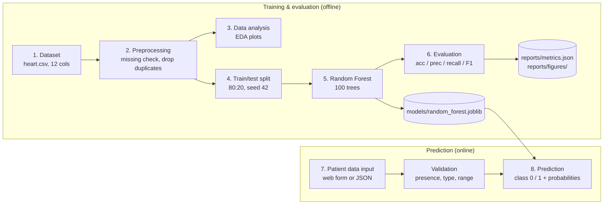

# Architecture

## 1. System workflow (matches slide 11 of the presentation)



## 2. Layered design

```
┌───────────────────────────────────────────────────────────┐
│ Presentation   app/app.py (Flask)  ·  templates/ + static │
│                REST: POST /api/predict · GET /health      │
├───────────────────────────────────────────────────────────┤
│ Service        heart_disease/predict.py                   │
│                validate_patient() → predict_one()         │
├───────────────────────────────────────────────────────────┤
│ ML core        data.py · eda.py · model.py ·              │
│                evaluate.py · train.py                     │
├───────────────────────────────────────────────────────────┤
│ Config         config.py (paths, features, ranges, seeds) │
├───────────────────────────────────────────────────────────┤
│ Artifacts      data/raw · models/ · reports/              │
└───────────────────────────────────────────────────────────┘
```

Dependencies only point downwards; the web app never touches raw data or training code.

## 3. Module responsibilities

| Module | Responsibility |
|---|---|
| `config.py` | Single source of truth: file paths, 11 feature names, valid ranges, split ratio, seeds, RF params |
| `data.py` | `load_raw` → `clean` (missing check, de-duplication, schema check) → `train_test` (80:20, `random_state=42`) |
| `eda.py` | Class balance, histograms, correlation heatmap, categorical-vs-target plots |
| `model.py` | `build_random_forest()` (project model) and `candidate_models()` (LogReg, Tree, RF, SVM, KNN) |
| `evaluate.py` | Accuracy, precision, recall, F1, ROC-AUC, confusion matrix, feature importance, 5-fold CV comparison |
| `train.py` | CLI orchestrating the whole offline pipeline and saving model + metrics |
| `predict.py` | Input validation and inference; CLI and library use |
| `app/app.py` | Flask UI and JSON API, delegates to `predict.py` |

## 4. Data contract

12 columns, all numeric: `age, sex, cp, trestbps, chol, fbs, restecg, thalach, exang, oldpeak, slope` (inputs) and `target` (0/1).
Any extra columns in the CSV (e.g. `ca`, `thal` in the full UCI file) are dropped by `data.clean`.
Expected for the real file: 1025 rows → 723 duplicates removed → 302 unique → 241 train / 61 test.

## 5. API

`POST /api/predict` with JSON of the 11 features →
```json
{"prediction": 1, "label": "class 1", "probability_class_0": 0.2, "probability_class_1": 0.8,
 "disclaimer": "Educational project ... not a medical diagnosis."}
```
Errors: `400` invalid/missing field, `503` model not trained yet.

## 6. Design decisions

- **Random Forest as the primary model**, exactly as in the presentation (100 trees, seed 42). The other four algorithms are compared by cross-validation as an extension (slide 15 "future scope").
- **Same split as the slides** (no stratification) so the 241/61 counts reproduce.
- **Model saved with feature order**, so prediction always builds the input frame in the training column order.
- **Validation before inference**: out-of-range or non-numeric values return 400 rather than a meaningless prediction.
- **Disclaimer in every response**: output is class 0/1 per the dataset label, not a diagnosis.

## 7. Possible extensions

Hyper-parameter tuning (GridSearchCV), SHAP explanations, Streamlit front-end, auth and audit logging for privacy, model versioning, validation by medical experts.
